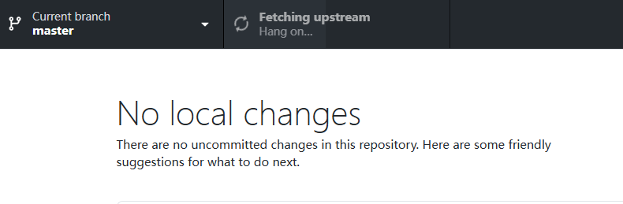
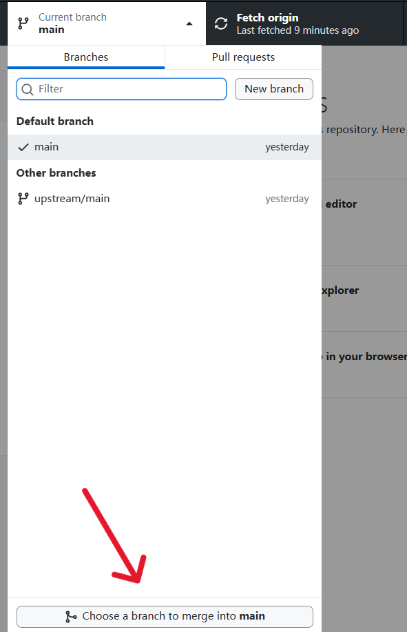
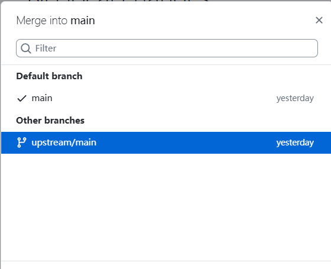

# 电控组第二次培训

## 1. 学习内容

本次培训主要讲解中断和定时器的相关知识，以及状态机的设计，需要掌握外部中断和定时器的输入捕获、输出比较模式，定时器中断，状态机的设计；相关资料可参考中科大RM电控合集2.3,2.4,2.6，keysking的中断、定时器、pwm部分；状态机部分可参考以下文章：https://mp.weixin.qq.com/s?src=11&timestamp=1791166002&ver=7007&signature=WRofwunHUz0fAfLMUxDJOUuJ6Z5RVCEkfCWIMk7RxG*Kol8RZq6sM5kvTHzf37Zdis7*UDj2A7e0eXENZwLz5YakRNhKfYUmXfRX4sydfXLtMm5VEMyAdrpuyVawDKyV&new=1

## 2. 作业

设计状态机，LED灯初始状态设为熄灭，使LED灯按照“熄灭->常亮->呼吸灯->熄灭->常亮->......”循环切换状态，通过外部中断的方式用按键触发LED灯状态转移。完成时间为两周，即10月18号截止，提交内容包括工程代码和演示视频。

## 3. 物料清单

与第一次培训相同。

## 4. 关于如何把新作业同步到本地

由于后面我们会继续在原仓库上发布新作业，但你之前fork的仓库不会自动同步原仓库更新的内容。这时我们需要在github desktop里点击fetch origin，我们会看到它会出现fetching upstream的提示，这是它在获取原仓库更新的内容；接着点击current branch，点击下方的“choose a branch to merge into main",然后选择“upstream/main”，这样就把上游原仓库的更新合并到你本地的main分支了，最后再点击“Push origin”推送到你fork的仓库。

